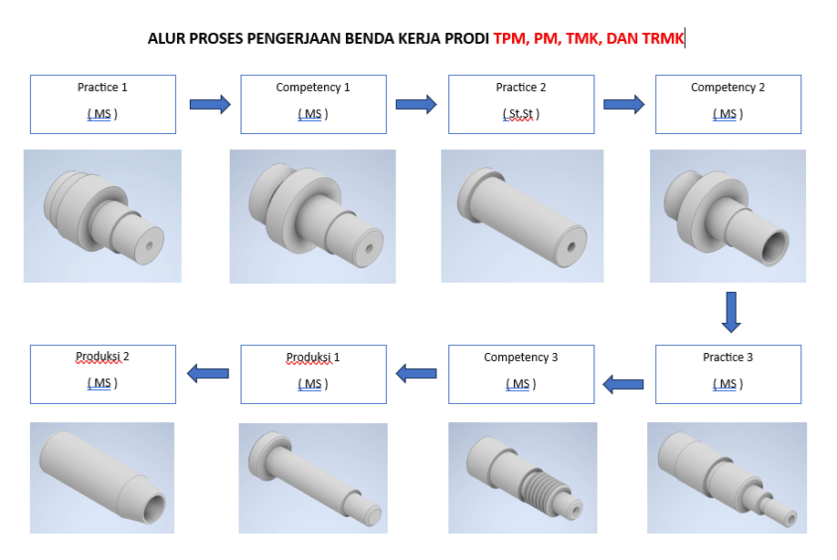

# PANDUAN FOTO DAN GAMBAR — PEMBELAJARAN SECTION TURNING (LW)

**Versi GitHub Assets (tanpa Supabase).** Website mengambil setiap foto dan gambar langsung dari repository GitHub Pages. Mengganti gambar dilakukan melalui GitHub, **bukan** melalui tombol di website. Tidak ada login admin/upload/delete yang terlihat di halaman. Materi, menu, dan simulasi bubut 3D tetap ada.

## 1. Susunan folder yang benar

Simpan `index.html` di root repository, sejajar dengan folder `assets`.

```text
nama-repository/
├── index.html
└── assets/
    └── img/
        ├── logo-atmi.png
        ├── instruktur/
        │   ├── agustinus-dewandana.jpg
        │   └── andhy-rinanto.jpg
        ├── section_lw/
        │   ├── section_lw_image22.png
        │   ├── section_lw_image16.png
        │   ├── section_lw_image23.png
        │   ├── section_lw_image18.png
        │   └── ... (nama lain lihat CSV)
        ├── alat_ukur/
        │   └── ... (lihat CSV)
        └── ulir/
            └── ... (lihat CSV)
```

HTML merujuk **72 berkas gambar unik** dengan path `assets/img/...`: 25 gambar `section_lw`, 34 `alat_ukur`, 10 `ulir`, 2 foto `instruktur`, dan 1 logo. Berkas foto/gambar asli **tidak disertakan** dalam paket karena belum tersedia; Anda perlu menambahkannya dari koleksi asli sendiri. Folder contoh `.gitkeep` hanya penanda folder kosong.

## 2. Cara memasukkan foto/gambar ke GitHub melalui browser

1. Login di **github.com**, buka repository website Pembelajaran Turning.
2. Pastikan `index.html` berada di **halaman utama (root)** repository.
3. Buka folder `assets` → `img` → pilih subfolder yang sesuai. Bila folder belum ada, buat melalui **Add file → Create new file** dan beri nama, misalnya `assets/img/instruktur/.gitkeep`, lalu **Commit changes**.
4. Masuk ke folder tersebut → **Add file → Upload files** → pilih/seret file JPG, PNG, JPEG sesuai nama yang tercantum di HTML atau di `DAFTAR_NAMA_FILE_GAMBAR.csv`.
5. Periksa nama file dan ekstensinya **sama persis**, kemudian klik **Commit changes**.
6. Setelah GitHub Pages memperbarui situs, buka kembali website dan gunakan `Ctrl+F5` / buka tab privat jika gambar belum berubah karena cache.

**Mengganti foto:** Upload file baru dengan **nama yang sama** pada folder yang sama, dan commit untuk menimpa file lama. **Menghapus foto:** buka file di repository → menu `...` → Delete file → commit. Setelah dihapus, website menampilkan placeholder *Foto belum tersedia* atau *Gambar belum tersedia*.

> Penting: Nama file, huruf kapital/kecil, dan ekstensi harus tepat. `instruktur/andhy-rinanto.jpg` **berbeda** dengan `Instruktur/Andhy-Rinanto.JPG`. File PNG jangan cuma diubah ekstensi namanya menjadi `.jpg` — ekspor/konversi benar-benar ke JPEG, atau ubah `src` HTML agar berakhiran `.png`.

## 3. Foto instruktur

| Nama | Upload foto persis ke |
|---|---|
| Agustinus Dewandana | `assets/img/instruktur/agustinus-dewandana.jpg` |
| Andhy Rinanto | `assets/img/instruktur/andhy-rinanto.jpg` |
| Logo Politeknik ATMI (pojok kiri header) | `assets/img/logo-atmi.png` |

**Contoh kode yang sudah ada di HTML:**

```html


```

Disarankan foto potret 600 × 800 piksel atau lebih, rasio mendekati 4:5. Foto instruktur ditampilkan dengan `object-fit: cover` sehingga area wajah menjadi fokus. Untuk menggeser titik fokus wajah, edit bagian CSS pada `index.html`:

```css
.instructor-photo-img {
  object-position: center 28%; /* 28% -> 50% jika ingin lebih ke tengah vertikal */
}
```

Untuk mengubah luas bidang foto, edit `.instructor-photo` dan nilai `aspect-ratio: 4/4.7` atau `max-height: 255px`. Bila ingin foto tidak terpotong, ubah `.instructor-photo-img` dari `object-fit:cover` menjadi `object-fit:contain`.

## 4. Gambar empat tahapan yang pernah tidak tampil

| Kartu/materi | File yang harus diunggah |
|---|---|
| TPM · PM · TMK · TRMK | `assets/img/section_lw/section_lw_image22.png` |
| TMI & RTM | `assets/img/section_lw/section_lw_image16.png` |
| TMI & RTM — lanjutan 2 | `assets/img/section_lw/section_lw_image23.png` |
| TMI & RTM — lanjutan 3 | `assets/img/section_lw/section_lw_image18.png` |

Jika JPG berisi tulisan, diagram, atau tabel, unggah dalam resolusi cukup tinggi (misalnya lebar 1500–2200 piksel untuk gambar yang sarat teks), dan sebaiknya **tidak di-crop**. Pada versi HTML ini gambar yang teridentifikasi sebagai tabel/form/tahapan ditampilkan `width:100%;height:auto;max-height:none`. Gambar juga bisa diklik untuk membuka pratinjau diperbesar dengan tombol `+`, `−`, dan `Reset`.

Untuk menyesuaikan tampilan satu gambar secara manual dalam `index.html`, contoh:

```html
<div class="figure zoomable">
  
</div>
```

Ini bukan upload lewat website; saat mengganti isi JPG/PNG dengan nama yang sama di GitHub, semua pengunjung memperoleh pembaruan setelah cache/server disegarkan.

## 5. Menambahkan gambar BARU yang sebelumnya belum ada di materi

1. Upload file ke folder misalnya `assets/img/section_lw/proses-knurling.jpg`.
2. Buka `index.html` di repository → ikon pensil (Edit file).
3. Temukan bagian materi sesuai nama menu, dan tambahkan HTML berikut pada konten menu tersebut (di dalam template string):

```html
<div class="figure zoomable">
  
  <div class="fig-cap">Proses knurling</div>
</div>
```

4. Klik **Commit changes**. Untuk mengganti gambar lama, cukup unggah berkas bernama sama tanpa mengedit HTML.

## 6. Cara menguji path dan menangani gambar yang kosong

- Buka foto langsung dari URL GitHub Pages: `https://NAMAUSER.github.io/NAMAREPO/assets/img/instruktur/agustinus-dewandana.jpg` (contoh untuk **project pages**; ganti USER/REPO Anda). Jika 404, folder/nama/ekstensi salah atau belum diunggah.
- **Gunakan path relatif** `assets/img/...` tanpa garis miring depan. Pada project pages, `/assets/img/...` bisa salah karena mengarah ke root domain, bukan subfolder repository.
- Jangan menaruh gambar hanya di root repository, atau di folder `assets` tanpa subfolder `img`, jika HTML merujuk `assets/img/...`.
- Bila gambar tidak ditemukan, website ini akan menampilkan nama path yang perlu diisi, bukan editor upload.
- Jika pengunjung masih melihat versi lama, tunggu deployment GitHub Pages selesai lalu lakukan refresh paksa atau buka mode incognito.

## 7. Berkas pada paket

- `index.html`: kode website terbaru yang mengambil media dari GitHub `assets/img`.
- `DAFTAR_NAMA_FILE_GAMBAR.csv`: daftar **72 nama file unik** yang dirujuk website untuk pengecekan upload.
- Folder `assets/img/...` hanya berisi `.gitkeep` agar struktur tetap terbentuk di ZIP; **tidak ada gambar asli di dalam paket**.

**Penting:** Jangan mengunggah ZIP mentah ke GitHub dan berharap terurai otomatis. Ekstrak ZIP dahulu, lalu upload `index.html` dan isi folder `assets` dengan struktur yang benar.
